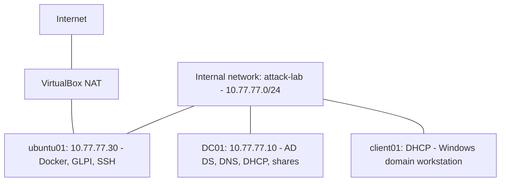

# IT Support HomeLab

A three-VM VirtualBox lab built to practise Windows domain administration, Linux service deployment, troubleshooting and service desk workflows. This is a personal learning project using fictional staff accounts.

## Environment

| Machine | Operating system | Address | Role |
| --- | --- | --- | --- |
| DC01 | Windows Server with Desktop Experience | 10.77.77.10 | Active Directory Domain Services, DNS, DHCP and departmental file shares |
| client01 | Windows 11 Enterprise Evaluation | DHCP: 10.77.77.100–199 | Domain workstation and user testing |
| ubuntu01 | Ubuntu Server | 10.77.77.30 | Docker Compose, MySQL, GLPI and SSH |

Domain: `lab.test`. Internal network: `attack-lab`, subnet `10.77.77.0/24`. Ubuntu has an additional VirtualBox NAT adapter for internet access. These addresses belong to the local lab; the services are not public demo endpoints.

## What I implemented

- An Active Directory domain with 20 fictional staff accounts across Sales, Finance, Warehouse and IT.
- Organisational units for staff, groups and workstations.
- Departmental access using AGDLP: accounts join global groups, which are nested in domain local groups that receive permissions.
- Four departmental shares with share and NTFS permissions, plus Group Policy drive mappings targeted by group membership.
- DNS and an authorised DHCP server with a client pool of `10.77.77.100–199`.
- Group Policy exercises covering desktop settings, password policy and account lockout.
- An Ubuntu server with a static lab address, remote administration over SSH and a GLPI/MySQL deployment using Docker Compose.
- A GLPI support group, two technician accounts, a customer account and a one-hour Time to Own SLA applied to practice tickets.

GLPI accounts use its internal database; Active Directory authentication was not configured. Time to Own measures assignment, rather than the first written customer reply.

## Validation and troubleshooting

I tested domain sign-in, group membership, departmental access and recovery from deliberately introduced faults. Exercises included account lockout, account disablement, group membership changes, incorrect DNS settings, DHCP service interruption and a broken workstation trust relationship.

Evidence included Security event **4740** for account lockout, client NETLOGON event **3210** for a trust failure, and DHCP client event **1001** for an address acquisition failure. Detailed checks and recovery steps are recorded in the fault log and runbook.

For file access, Alice could create, edit, save and delete a test file in the Sales share. Earlier cross-department tests verified that an unauthorised user was denied access to Finance.

### GLPI database recovery

During deployment, GLPI repeatedly waited for its database even though the MySQL container reported healthy. Inspection showed that the application database and user were missing. Interrupted first-time initialization around a VM freeze/restart was the suspected cause.

I stopped the Compose services, backed up the configuration and switched MySQL to a fresh named volume, retaining the original volume. The next startup created the database and user successfully. I verified recovery through the initialization logs, browser sign-in and subsequent ticket workflows. This illustrated why a container health indicator alone is insufficient to prove an application is ready.

## Service desk exercises

| Ticket | Scenario | Handling |
| --- | --- | --- |
| 1 | Cannot access Sales shared drive | Simulated report. Priya responded; an actual file access test succeeded, so no permissions change was required. |
| 2 | GLPI unavailable: database initialization incomplete | Retrospective record of the deployment fault, diagnosis, recovery and verification, handled by Ryan. |
| 3 | Client01 unable to obtain an IP address | Retrospective record of the DHCP service exercise, handled by Priya. |

All three tickets were closed after customer approval. The ticket timestamps represent the practice workflow; retrospective tickets do not measure the original incident response times.

## Documentation and evidence

- [Documentation folder](Documentation/): network diagram, operations runbook and fault log, including PDF exports.
- [Screenshot evidence](Screenshots/): directory structure, group nesting, DHCP configuration, domain membership, mapped drive access, container status and completed tickets.

The runbook covers startup and shutdown order, expected health check results and recovery procedures. Screenshots support specific configuration and workflow claims; a file listing alone does not demonstrate all write/delete tests.

## Skills practised

Active Directory administration; DNS and DHCP troubleshooting; Group Policy; group-based file access; Windows event log investigation; workstation trust repair; Linux administration; SSH; Docker Compose; incident documentation; and technician/customer ticket workflows.

## Scope and limitations

This is a single-domain-controller learning environment, not a production deployment. GLPI is accessed over HTTP on the internal lab network. Backups, high availability, HTTPS and directory-integrated GLPI authentication would require further work. VM snapshots provide convenient rollback points but are not a substitute for independent backups.

Passwords, environment secrets, virtual disks and installation media are excluded from this portfolio.
