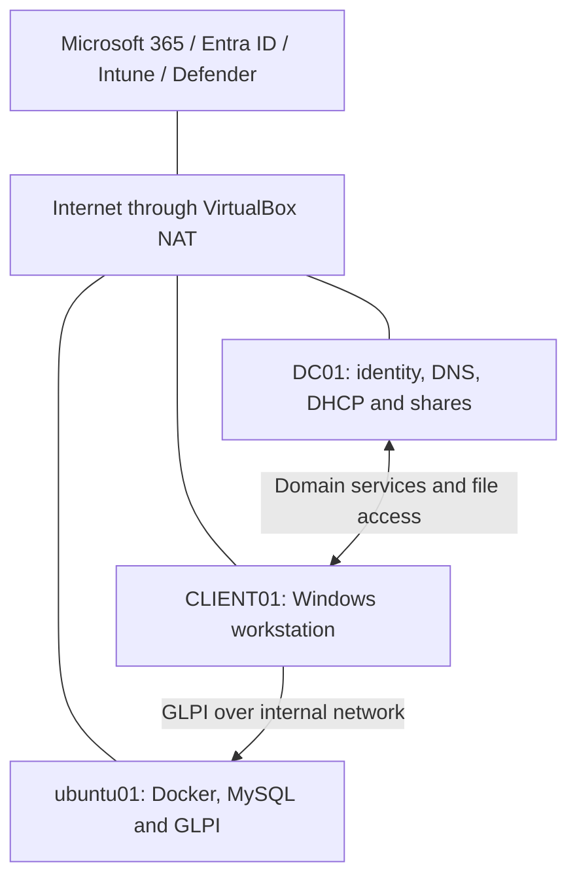

# Hybrid IT Support and Endpoint Security HomeLab

A three-VM VirtualBox lab built to practise IT support across an on-premises Windows domain, Microsoft 365 and endpoint security. The project combines Active Directory, Linux-hosted GLPI, hybrid identity, Intune device management and Microsoft Defender for Business, with documented troubleshooting and customer/technician ticket workflows.

This is a personal learning project using fictional staff accounts. The core infrastructure and subsequent Microsoft 365 and Defender exercises are documented below. Open findings and testing limitations are recorded separately from successful checks.

## Selected results

- Verified departmental file permissions and group-targeted drive mappings, including allowed and denied access.
- Synchronised lab identities to Microsoft Entra ID and tested MFA, password writeback and cloud sign-in recovery.
- Enrolled CLIENT01 in Intune and verified compliance, configuration and Company Portal deployment.
- Investigated and resolved authorised Defender PowerShell and EICAR test incidents.
- Remotely triggered an antivirus scan and demonstrated device isolation, loss of Sales access and recovery after release.
- Patched Windows from build `26200.6584` to `26200.9711`. Defender findings fell from **2,849 to 57** after reassessment; the remaining findings related to OpenSSL.

## Environment

| Machine | Operating system | Lab address | Role |
| --- | --- | --- | --- |
| DC01 | Windows Server with Desktop Experience | `10.77.77.10` | AD DS, DNS, DHCP, departmental shares and Entra Connect Sync |
| CLIENT01 | Windows 11 Enterprise Evaluation | DHCP pool: `10.77.77.100–199` | Domain workstation, hybrid identity, Intune and Defender testing |
| ubuntu01 | Ubuntu Server | `10.77.77.30` | Docker Compose, MySQL, GLPI and SSH |

Domain: `lab.test`. Internal network: `attack-lab`, subnet `10.77.77.0/24`. Additional VirtualBox NAT adapters provide internet access for updates and cloud services. The DHCP pool above is a range, not CLIENT01's fixed address. These addresses belong to the local lab; the services are not public demo endpoints.

## 1. Core infrastructure and IT support

- Built an AD domain with 20 original fictional staff accounts across Sales, Finance, Warehouse and IT; added another user during a later onboarding exercise.
- Created organisational units for staff, groups and workstations.
- Implemented AGDLP: accounts join global groups, nested in domain local groups that receive permissions.
- Configured four departmental shares with share and NTFS permissions, plus Group Policy drive mappings targeted by group membership.
- Configured DNS and an authorised DHCP server with the client pool shown above.
- Practised desktop settings, password policy and account lockout through Group Policy.
- Deployed GLPI and MySQL on Ubuntu using Docker Compose, with SSH for remote administration.
- Configured GLPI technician/customer workflows and a one-hour Time to Own SLA for practice tickets.

GLPI uses its internal account database; AD authentication was not configured. Time to Own measures assignment rather than the first written customer reply.

### Validation and troubleshooting

Tested domain sign-in, group membership, departmental access and recovery from deliberately introduced faults. Exercises included account lockout, account disablement, group membership changes, incorrect DNS settings, DHCP service interruption and a broken workstation trust relationship.

Evidence included Security event **4740** for account lockout, client NETLOGON event **3210** for a trust failure, and DHCP client event **1001** for an address acquisition failure. Detailed checks and recovery steps are recorded in the fault log and runbook.

Alice could create, edit, save and delete a test file in Sales. Cross-department testing verified that an unauthorised user was denied access to Finance. Stopping DHCP was tested in an address-acquisition scenario; it does not imply that stopping DHCP immediately disconnects every client with a valid lease.

### GLPI database recovery

During deployment, GLPI repeatedly waited for its database even though the MySQL container reported healthy. Inspection showed that the application database and user were missing. Interrupted first-time initialization around a VM freeze/restart was the suspected cause.

I stopped the Compose services, backed up the configuration and switched MySQL to a fresh named volume, retaining the original volume. The next startup created the database and user successfully. Initialization logs, browser sign-in and subsequent ticket workflows verified recovery. A container health indicator alone was insufficient to prove application readiness.

## 2. Hybrid identity, Microsoft 365 and Intune

- Configured Microsoft Entra Connect Sync with scoped organisational units and password hash synchronisation.
- Configured password writeback and verified a self-service password reset through subsequent AD sign-in and Sales access.
- Tested Exchange Online mail access and mail flow using lab users.
- Enabled a Conditional Access policy requiring MFA and verified an Authenticator challenge. Kept a separate emergency administrator excluded from the lab policies.
- Tested a location-based policy using What If. The policy to block access outside the UK remained **report-only**; geographic blocking was not enforced.
- Verified CLIENT01's hybrid join state and enrolled it in Intune through the manual MDM-only enrolment flow. Its recorded ownership was **Personal**.
- Deployed Windows compliance and Edge configuration policies, plus the Microsoft Store Company Portal application.
- Practised user onboarding, MFA method recovery with a Temporary Access Pass, device compliance recovery, cloud sign-in unblock and password synchronisation troubleshooting.

Automatic MDM enrolment was configured during troubleshooting, but the successful enrolment used the manual flow. The compliance exercise demonstrated reporting and recovery; it did not demonstrate Conditional Access blocking an application because the device was noncompliant.

## 3. Microsoft Defender for Business

### Deployment and managed protection

Verified the Intune–Defender connection, successful EDR onboarding and CLIENT01's Active/Onboarded state. Assigned the device to `LAB - Defender Devices` for lab security policies.

Deployed managed antivirus settings, tamper protection and Domain/Private/Public firewall protection. Configured the PSExec/WMI process-creation ASR rule in **Audit** mode. Later added Controlled folder access in **Audit** mode and verified `EnableControlledFolderAccess` returned `2` locally.

### Detection, investigation and response

- **Official EDR test:** reviewed the PowerShell alerts, process tree, command line and evidence in incident #1. Classified the authorised activity as expected security testing and resolved it. The evidence demonstrated detection, not blocking or quarantine.
- **EICAR test:** Windows Security detected and **removed** the harmless test file from Alice's Downloads folder. Cloud incident #2 confirmed reporting; the incident was documented and resolved as expected security testing.
- **Remote Quick scan:** the portal confirmed successful triggering. Local timestamps showed the scan ran from 22:01:22 to 22:04:13 on 20 October 2026.
- **Isolation and recovery:** isolated CLIENT01 through Defender, confirmed Sales access was blocked, released isolation and verified access returned.
- **Vulnerability remediation:** applied Windows security update KB5127648 and verified build `26200.9711`, normal Sales access and subsequent reduction from 2,849 to 57 vulnerability findings.

### Remaining findings

The 57 remaining findings related to OpenSSL bundled with Microsoft applications and components, including OneDrive copies in several user profiles. Installed available Store app updates and reviewed Alice's OneDrive version against Microsoft's release notes. This did not establish remediation of every affected file; the OpenSSL finding remains open.

Controlled folder access Audit mode was verified locally, while its Defender recommendation remained visible at the last check. Portal assessment and local configuration are recorded separately.

## Service desk exercises

The table summarises selected tickets. Additional Microsoft 365 exercises are described in the lab notes; ticket numbering is not a count of unique exercises.

| Ticket | Scenario | Investigation and outcome |
| --- | --- | --- |
| #1 | Cannot access Sales | Simulated report; actual access succeeded, so no permissions change was required. |
| #2 | GLPI database initialization incomplete | Retrospective deployment fault: diagnosed missing database/user and verified recovery using a fresh MySQL volume. |
| #3 | CLIENT01 cannot obtain an IP address | Retrospective DHCP service troubleshooting exercise. |
| #9 | Downloaded EICAR file disappeared | Confirmed antivirus detection and removal using Windows Security and Defender incident #2. |
| #10 | Cannot change antivirus settings | Confirmed protection remained enabled and the controls were centrally managed. |
| #11 | CLIENT01 missing from Defender inventory | Removed a Linux platform filter; the device reappeared without re-onboarding. |
| #12 | GLPI blocked from CLIENT01 | Removed a temporary outbound rule targeting `10.77.77.30:8080`; TCP testing and browser access confirmed recovery. |

The four Defender tickets were handled by Priya Shah and closed following Alice's acceptance. Defender portal checks used the authorised lab administrator account; a GLPI ticket assignment does not grant Defender permissions. Retrospective ticket timestamps represent the practice workflow, not the original response times.

## Documentation and evidence

- [Documentation](Documentation/): original network diagram, operations runbook, fault log and lab notes.
- [Core screenshot evidence](Screenshots/): AD structure, group nesting, DHCP, domain membership, shares, containers and support workflows.
- [Microsoft 365 evidence](M365-Evidence/): supporting evidence from the hybrid identity and cloud management extension.
- [Defender documentation](Defender/Documentation/): Defender lab notes and exported documentation.
- [Defender screenshots](Defender/Screenshots/): policy deployment, incidents, scanning, isolation, patching and troubleshooting evidence.

The runbook covers startup/shutdown order, health checks and recovery procedures. Screenshots support specific claims; a file listing alone does not prove write/delete access, and policy deployment alone does not prove a detection was triggered.

## Skills practised

Active Directory; DNS and DHCP; Group Policy; group-based file permissions; Windows event investigation; workstation trust repair; Linux and SSH; Docker Compose; GLPI ticket handling; Entra Connect; hybrid identity; MFA and Conditional Access; password writeback; Intune enrolment, compliance and app deployment; Defender incident investigation; remote response; vulnerability assessment; patch verification; and evidence-based documentation.

## Scope and limitations

- This is a single-domain-controller learning environment, not a production deployment. Cloud functionality depends on the lab subscription and licensing.
- GLPI uses internal HTTP and local accounts. Independent backups, high availability, HTTPS and directory-integrated GLPI authentication require further work. Snapshots are rollback points, not independent backups.
- Defender testing covered CLIENT01; it does not establish protection of DC01, Ubuntu or the host PC. This extension is endpoint security, not a deployed SIEM.
- ASR and Controlled folder access Audit mode were configured, but actual audit events were not demonstrated. Audit mode does not enforce blocking.
- Administrator tamper-resistance testing, phishing/SmartScreen testing and automated investigation were not demonstrated.
- OpenSSL findings remain open. Completing the documented exercises does not mean every vulnerability or security recommendation has been resolved.

Passwords, authentication secrets, environment files containing credentials, virtual disks and installation media are excluded from this portfolio.

*Last updated: 21 October 2026. Findings and counts describe the recorded lab assessment, not a continuously monitored live status.*
